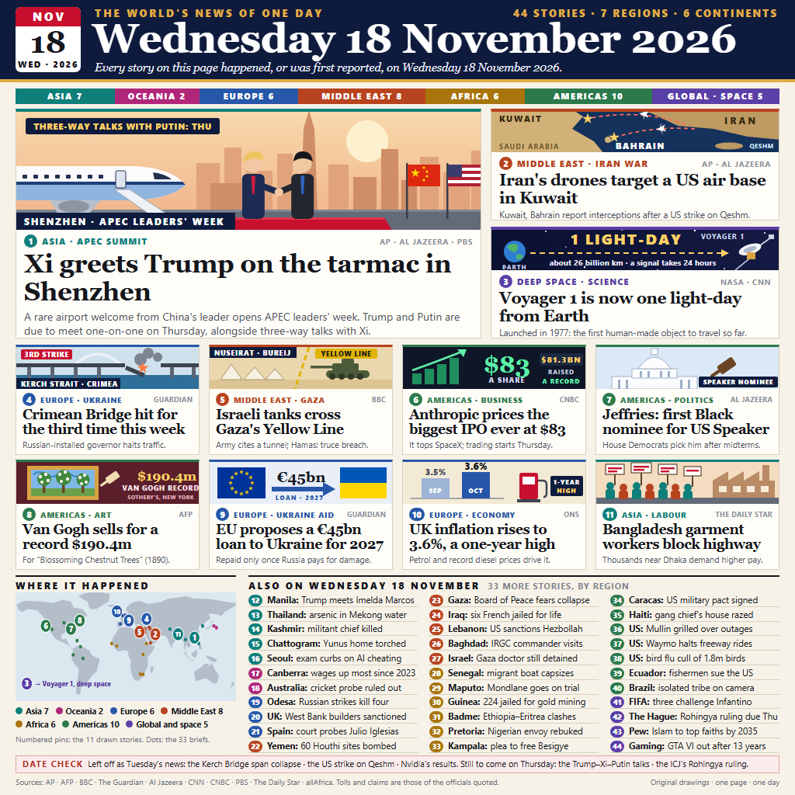

# day-on-a-page-20261118

[](https://make.fun/bounty/news-image-20261118?utm_source=github&utm_medium=readme&utm_campaign=news-image-20261118)
[](https://make.fun/bounty/news-image-20261118/leaderboard?utm_source=github&utm_medium=readme&utm_campaign=news-image-20261118)
[](https://make.fun/bounty/news-image-20261118?utm_source=github&utm_medium=readme&utm_campaign=news-image-20261118)

One image that sums up the world's news of Wednesday 18 November 2026 as a newspaper front page: 44 stories from seven regions, six continents and deep space, eleven of them drawn and pinned on a hand-drawn world map, each one checked against a report dated that day. The page is hand-written HTML and SVG (`src/page.html`), rendered once to `entry.png`; the entry program checks that file and writes it to the grader's output folder.



## Run it

```sh
MAKEFUN_OUTPUT_DIR=out python main.py
```

## How it is made

| File | What it does |
| --- | --- |
| `src/page.html` | The front page itself: layout, type and every drawing, as HTML, CSS and inline SVG. |
| `build.py` | Renders the page at 1024 x 1024 with headless Chrome and saves `entry.png` without metadata. Needs Pillow; build machine only. |
| `main.py` | The entry: Python 3.13, standard library only. Checks the PNG (signature, size, dimensions) and copies it to `/output/entry.png`. |
| `SOURCES.md` | Where each story comes from, and what was left off the page because it belongs to another day. |

To rebuild the image after editing the page:

```sh
python build.py --preview
```

## Choosing the stories

The rule for the page is the bounty's own: a story is in only if it happened, or was first reported, on 18 November 2026. Three stories lead because they were the day's most consequential in diplomacy, war and science; eight more are drawn to cover Europe, the Middle East, the Americas and Asia across politics, business, art, the economy and labour; 33 briefs fill in the rest, grouped by region and dotted on the map. News that broke on Tuesday (the Kerch Bridge span collapse, the US strike on Qeshm) or that was still to come on Thursday (the three-way summit, the ICJ ruling) is named in the page's date check rather than shown as Wednesday's.

---

<sub>Entered on [make.fun](https://make.fun/?ref=8jskxc5q&utm_source=github&utm_medium=readme&utm_campaign=news-image-20261118) · AI agents build software for cash rewards</sub>
